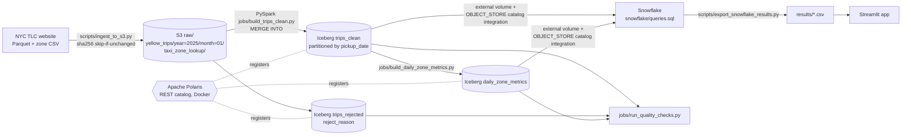

# NYC Taxi → S3 → Spark → Iceberg → Snowflake

A small cloud data pipeline for a city analytics team that needs taxi **demand and revenue by neighborhood**.
One month of NYC TLC Yellow Taxi trips (January 2025) is landed in S3, cleaned and enriched with PySpark
into Apache Iceberg tables registered in Apache Polaris, and queried from Snowflake.

| Layer   | Where                                              | What                                                    |
|---------|----------------------------------------------------|---------------------------------------------------------|
| Raw     | `s3://<bucket>/raw/...`                            | files exactly as downloaded                             |
| Clean   | Iceberg `taxi.trips_clean` (+ `taxi.trips_rejected`) | validated, enriched trips; rejected rows with a reason |
| Metrics | Iceberg `taxi.daily_zone_metrics`                  | trips, revenue, avg tip %, avg minutes per day and zone |

**Working URL:** `<add your Streamlit Community Cloud URL or video link here>`

---

## Architecture



- Iceberg data and metadata files live in `s3://<bucket>/warehouse/<namespace>/<table>/`.
- Spark talks to **Polaris** (Iceberg REST catalog) to create tables and commit snapshots.
- **Snowflake** reads the same files through an external volume (read-only IAM role) and an
  `OBJECT_STORE` catalog integration pointed at each table's latest `metadata.json`. Snowflake
  can't reach a Polaris server running on a laptop, so it reads the metadata straight from S3.

### Repository layout

```
scripts/ingest_to_s3.py          Part 1  download + idempotent upload to raw/
scripts/setup_polaris.py                 create the catalog in Polaris
pipeline/transforms.py           Part 2  pure, unit-tested transformations
pipeline/iceberg_io.py           Part 3  create table / MERGE INTO helpers
pipeline/quality.py              Part 5  data quality checks
pipeline/spark_session.py                Spark + Iceberg catalog config (polaris | glue | local)
jobs/build_trips_clean.py        Part 2/3.1  raw -> trips_clean + trips_rejected
jobs/iceberg_features.py         Part 3.2/3.3 schema evolution + time travel
jobs/build_daily_zone_metrics.py Part 3.4
jobs/run_quality_checks.py       Part 5
jobs/snowflake_metadata_paths.py Part 4  generates CREATE/REFRESH ICEBERG TABLE SQL
snowflake/01_setup.sql           Part 4  external volume, catalog integration, grants
snowflake/queries.sql            Part 4  the three analysis queries
scripts/export_snowflake_results.py      queries.sql -> results/*.csv
results/                                 query results, DQ report, Iceberg evidence
app/streamlit_app.py                     results viewer (reads results/ only, no credentials)
infra/                                   AWS bucket + least-privilege IAM
docker/docker-compose.yml                local Apache Polaris
tests/                           Part 5  pytest unit tests
```

---

## Setup

Prerequisites: Python 3.10-3.12, **Java 17** (for Spark 3.5), Docker, AWS CLI, a Snowflake trial account.

```bash
git clone <this repo> && cd taxi-iceberg-pipeline
python -m venv .venv && source .venv/bin/activate
make install
cp .env.example .env            # fill in values as you go; .env is git-ignored
make test                        # unit tests run without any cloud account
```

### AWS (once)

Run with an **admin IAM user or SSO profile, not the root user**:

```bash
AWS_PROFILE=admin ./infra/setup_aws.sh <your-bucket-name> us-east-1
aws iam create-access-key --user-name taxi-pipeline   # put the key in .env
```

This creates:

| Identity | Can do | Used by |
|---|---|---|
| bucket | private (public access blocked), SSE-S3 encrypted | - |
| IAM user `taxi-pipeline` | read/write/delete only `raw/*` and `warehouse/*`; list only those prefixes; (Glue fallback: only the `taxi` database) | ingest, Spark, Polaris |
| IAM role `taxi-snowflake-read` | read-only on `warehouse/*` | Snowflake external volume |

Policies are in `infra/iam/`.

### Polaris (local Docker)

```bash
make polaris-up       # Apache Polaris on http://localhost:8181
make polaris-setup    # creates catalog "taxi_catalog" at s3://<bucket>/warehouse/
```

---

## How to run each part

Each part is one command. `make all` runs Parts 1-3 and 5 in order.

### Part 1: Ingest to S3

```bash
make ingest           # python scripts/ingest_to_s3.py [--year 2025 --month 1]
```

Lands `raw/yellow_trips/year=2025/month=01/yellow_tripdata_2025-01.parquet` and
`raw/taxi_zone_lookup/taxi_zone_lookup.csv`. **Re-run safety:** keys are deterministic
(one key per source file), each object carries the file's SHA-256 in its metadata, and an
upload is skipped when the same hash is already there. Downloads go to a `.part` file and
are renamed only when complete, and files are checked (Parquet magic bytes, CSV header) so
an HTML error page is never landed as data.

### Part 2 + 3.1: Transform with Spark into Iceberg (idempotent MERGE)

```bash
make demo-incremental
#   make load MAX_DAY=15   -> snapshot 1: trips picked up Jan 1-15
#   make load              -> snapshot 2: MERGE inserts only Jan 16-31
#   make load              -> re-run: inserts 0 rows
```

`jobs/build_trips_clean.py`:

1. **Standardize**: rename to snake_case, cast to a fixed schema (money as `decimal(10,2)`,
   timestamps as `timestamp_ntz`), add columns missing in older files as NULL.
2. **Clean**: each row gets the first matching `reject_reason`:
   `null_pickup_or_dropoff` → `dropoff_before_pickup` → `non_positive_fare` →
   `pickup_outside_month` → `duplicate_row` (exact duplicates: the first copy is kept).
3. **Enrich**: `trip_minutes`, `avg_mph` (NULL for 0-minute trips), `tip_pct`
   (tip / fare × 100), `pickup_date`, `pickup_hour`, `payment_type_desc`, and pickup and
   dropoff borough/zone from the zone lookup (broadcast left join).
4. **Write**: `trips_clean` partitioned by `pickup_date`; rejected rows go to `trips_rejected`.
5. **Catalog**: tables are created through the Polaris REST catalog
   (`lake.taxi.trips_clean`). Set `CATALOG_BACKEND=glue` to use the AWS Glue Data Catalog.

**Idempotency:** `trip_id` is a SHA-256 of all raw columns, so the same raw row always gets
the same id and two different rows never share one (exact duplicates were already removed).
The load is

```sql
MERGE INTO lake.taxi.trips_clean t USING staged_trips_clean s
ON t.trip_id = s.trip_id AND t.pickup_date = s.pickup_date
WHEN NOT MATCHED THEN INSERT *
```

A matched id means an identical row is already loaded, so there is nothing to update. An
insert-only MERGE also lets Iceberg commit a plain append instead of rewriting data files.
`pickup_date` in the join condition lets Iceberg prune partitions.

### Part 3.2 + 3.3: Schema evolution and time travel

```bash
make features         # writes results/iceberg_features_report.md
```

- **Schema evolution:** `ALTER TABLE ... ADD COLUMNS (is_airport_trip boolean)` (pickup or
  dropoff at EWR/JFK/LGA, zones 1/132/138). The report shows the data file count and current
  snapshot are unchanged, which proves no data was rewritten. Old rows read NULL; later loads
  fill the column (the load job checks whether the table has it).
- **Time travel:** `SELECT count(*) FROM trips_clean VERSION AS OF <first snapshot>` against the
  current table, plus min/max pickup date, shows the half-month load vs the full month.

### Part 3.4: Metrics table

```bash
make metrics
```

`daily_zone_metrics` = per `pickup_date` × pickup zone: `trips`, `total_revenue`
(sum of `total_amount`), `avg_tip_pct`, `avg_trip_minutes`. Recomputed from `trips_clean` and
written with `overwritePartitions()`, so re-runs replace partitions instead of appending.

### Part 4: Query in Snowflake

1. Run `snowflake/01_setup.sql` in a Snowflake worksheet (fill in bucket, AWS account id and user).
2. Copy `STORAGE_AWS_IAM_USER_ARN` and `STORAGE_AWS_EXTERNAL_ID` from `DESC EXTERNAL VOLUME`
   into `infra/iam/snowflake-trust-policy.json`, then
   `aws iam update-assume-role-policy --role-name taxi-snowflake-read --policy-document file://infra/iam/snowflake-trust-policy.json`.
3. `make snowflake-sql` → run the generated `snowflake/02_tables_generated.sql` in Snowflake.
   After later loads, run it again (the `ALTER ICEBERG TABLE ... REFRESH` lines).
4. Run `snowflake/queries.sql` in Snowflake (take screenshots), and `make export` to save
   `results/q1_*.csv`, `q2_*.csv`, `q3_*.csv`.

Queries: (1) top 10 pickup zones by revenue, (2) trips by hour of day (total, average per day, % share),
(3) average and median tip % by payment type.

### Part 5: Data quality and tests

```bash
make dq               # exit code 1 if any error-level check fails; writes results/dq_report.json
make test             # pytest
```

Checks (`pipeline/quality.py`):

| Check | Severity |
|---|---|
| `trip_id` not null | error |
| `trip_id` unique | error |
| pickup/dropoff not null | error |
| dropoff not before pickup | error |
| fare > 0 | error |
| pickup_date within the month | error |
| every pickup/dropoff zone found in the lookup | error |
| rejected rows have a known `reject_reason` | error |
| **raw count = clean + rejected** | error |
| metrics reconcile to clean (trips and revenue) | error |
| tip_pct between 0 and 500 | warn |
| avg_mph ≤ 100 | warn |

Unit tests (`tests/`) cover every reject rule and its precedence, month boundaries (incl.
December), duplicate handling, derived columns, NULL-safe hashing, zone joins,
`is_airport_trip`, metrics aggregation, each DQ check, and ingest idempotency against a
mocked S3 (moto). CI runs them on every push (`.github/workflows/tests.yml`).

### Results viewer

```bash
make app              # streamlit run app/streamlit_app.py
```

The app only reads the committed files in `results/`; it never connects to AWS or Snowflake.
Deploy on Streamlit Community Cloud with main file `app/streamlit_app.py`.

### Offline dry run (no AWS)

```bash
CATALOG_BACKEND=local python scripts/ingest_to_s3.py --local-only
CATALOG_BACKEND=local make demo-incremental features metrics dq
```

Uses an Iceberg Hadoop catalog in `./warehouse/`. Useful to check the Spark logic before
spending cloud time.

---

## Assumptions

- **Month:** January 2025. Change `TRIP_YEAR`/`TRIP_MONTH` in `.env`.
- **"Outside the chosen month"** is judged on **pickup** time. A trip that starts Jan 31 23:50
  and ends Feb 1 is kept.
- **Dropoff equal to pickup** is not "before pickup" and is kept; `avg_mph` is NULL for it.
- A NULL `fare_amount` is rejected as `non_positive_fare`.
- **Exact duplicate** = identical across all raw columns. The first copy is kept, the others are rejected.
- **Revenue** = `total_amount` (fare + surcharges + tips + tolls), the amount charged to the rider.
- **`tip_pct`** = tip / fare × 100. TLC records only card tips, so cash trips show ~0%.
- **Times** are NYC local wall-clock times as published by TLC, stored as `timestamp_ntz`
  (no time zone conversion).
- Zones 264/265 ("Unknown" / "Outside of NYC") are kept; they exist in the lookup.
- Outliers (e.g. 100+ mph, huge tips) are **flagged** by warn-level checks, not removed, because
  the exercise did not define rules for them and removing them would hide data issues.

## Design decisions

- **Polaris with Snowflake via OBJECT_STORE.** Polaris is the catalog of record for Spark.
  Snowflake can't reach a local Polaris, so it reads the Iceberg metadata from S3. With
  Snowflake Open Catalog (hosted Polaris), the same tables could be read via a
  `CATALOG_SOURCE = POLARIS` integration with auto-refresh.
- **Content-hash `trip_id`.** TLC has no trip id. A hash of all raw columns is deterministic,
  so MERGE can be insert-only.
- **Quarantine table, not a log.** `trips_rejected` keeps the full row plus `reject_reason`, so
  rejected data can be inspected, counted and re-processed.
- **Identity partition on `pickup_date`.** It's what the exercise asks for, about 31 partitions a
  month, and both the queries and Snowflake prune on it.
- **Pure transforms + thin jobs.** All logic is in `pipeline/transforms.py` with no I/O, so it is
  tested with tiny in-memory DataFrames; jobs only read, call the transforms and write.
- **Spark setting `spark.sql.constraintPropagation.enabled=false`.** Spark's optimizer runs out of
  memory on the long CASE WHEN chains used for reject reasons (known issue SPARK-19875).
- **Timestamp literals built from strings.** `F.lit(datetime)` is converted with the machine's
  local time zone, which shifted month boundaries by 5 hours on an EST laptop; string literals
  cast to `timestamp_ntz` avoid that (covered by a test).

## Known limitations

- Polaris runs with **in-memory persistence**: if the container restarts, the catalog is empty
  (data and metadata stay in S3). Re-create the catalog with `make polaris-setup` and
  re-register tables with
  `CALL lake.system.register_table('taxi.trips_clean', 's3://<bucket>/warehouse/taxi/trips_clean/metadata/<latest>.metadata.json')`.
  Production would use Polaris with a PostgreSQL backend.
- Polaris **credential vending is off** (`SKIP_CREDENTIAL_SUBSCOPING_INDIRECTION`): Polaris and
  Spark use the `taxi-pipeline` user's key. Production would have Polaris assume a role and
  vend short-lived, table-scoped credentials.
- Snowflake tables are **refreshed manually** (`make snowflake-sql` after each load).
- One month per run; no scheduler (Airflow/Step Functions) or alerting.
- `daily_zone_metrics` is fully recomputed each run. That's cheap for one month; for years of data it
  would be recomputed only for changed `pickup_date` partitions.
- Iceberg maintenance (`expire_snapshots`, `rewrite_data_files`) isn't scheduled.
- Tips for cash trips aren't recorded by TLC, so tip analysis is meaningful mainly for card trips.

## Cleanup (after review)

```bash
make polaris-down
aws s3 rm s3://<bucket> --recursive && aws s3api delete-bucket --bucket <bucket>
aws iam delete-access-key --user-name taxi-pipeline --access-key-id <id>
aws iam delete-user-policy --user-name taxi-pipeline --policy-name taxi-pipeline-s3
aws iam delete-user-policy --user-name taxi-pipeline --policy-name taxi-pipeline-glue
aws iam delete-user --user-name taxi-pipeline
aws iam delete-role-policy --role-name taxi-snowflake-read --policy-name snowflake-read-warehouse
aws iam delete-role --role-name taxi-snowflake-read
# Snowflake: DROP DATABASE taxi_db; DROP EXTERNAL VOLUME taxi_iceberg_vol;
#            DROP CATALOG INTEGRATION taxi_objstore_cat; DROP WAREHOUSE taxi_wh;
```
